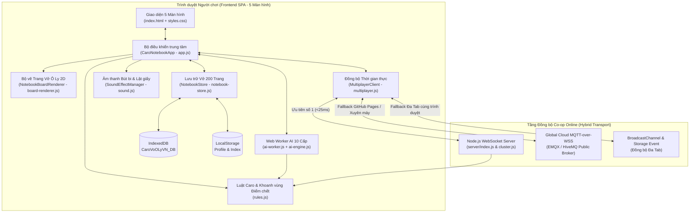

# 📘 Tài Liệu Vòng Đời Phát Triển Phần Mềm (SDLC) — Cờ Caro Vở Ô Ly Việt Nam

> **Tên dự án:** Cờ Caro Vở Ô Ly Việt Nam (`caro-vo-o-ly-vn`)  
> **Phiên bản tài liệu:** `1.4.0` (Cập nhật: `2026-10-17`)  
> **Repository:** `https://github.com/D-Khoa/caro-vn`  
> **Mục đích:** Tài liệu chuẩn hóa toàn bộ quy trình **SDLC (Software Development Life Cycle)** từ Yêu cầu nghiệp vụ, Kiến trúc hệ thống, Thiết kế dữ liệu, Giao thức mạng, Các bất biến kỹ thuật (Invariants) đến Quy trình kiểm thử và Hướng dẫn mở rộng tính năng mới.

---

## Mục Lục
1. [Giai đoạn 1: Phân tích Yêu cầu & Nghiệp vụ (Requirements & Domain Rules)](#1-giai-đoạn-1-phân-tích-yêu-cầu--nghiệp-vụ-requirements--domain-rules)
2. [Giai đoạn 2: Kiến trúc Hệ thống & Thiết kế Kỹ thuật (System Architecture & Design)](#2-giai-đoạn-2-kiến-trúc-hệ-thống--thiết-kế-kỹ-thuật-system-architecture--design)
3. [Giai đoạn 3: Thiết kế Dữ liệu & Giao thức Mạng (Data Schemas & Network Protocol)](#3-giai-đoạn-3-thiết-kế-dữ-liệu--giao-thức-mạng-data-schemas--network-protocol)
4. [Giai đoạn 4: Các Bất biến Kỹ thuật & Hướng dẫn Phát triển Tính năng Mới (Developer Playbook)](#4-giai-đoạn-4-các-bất-biến-kỹ-thuật--hướng-dẫn-phát-triển-tính-năng-mới-developer-playbook)
5. [Giai đoạn 5: Chiến lược Kiểm thử & Đảm bảo Chất lượng (Testing & QA Strategy)](#5-giai-đoạn-5-chiến-lược-kiểm-thử--đảm-bảo-chất-lượng-testing--qa-strategy)
6. [Giai đoạn 6: Triển khai, Vận hành & Bản quyền (Deployment, Operations & Licensing)](#6-giai-đoạn-6-triển-khai-vận-hành--bản-quyền-deployment-operations--licensing)

---

## 1. Giai đoạn 1: Phân tích Yêu cầu & Nghiệp vụ (Requirements & Domain Rules)

### 1.1. Yêu cầu Chức năng (Functional Requirements)
| Mã YC | Nhóm chức năng | Mô tả chi tiết |
| :--- | :--- | :--- |
| **FR-01** | **Trang Vở Ô Ly** | Bàn cờ chính là 1 trang vở ô ly học sinh kích thước `32 cột × 24 dòng` (`768 ô`), có lề đỏ đôi bên trái, ghim bấm gáy vở, dòng ghi `Thứ ... ngày ... tháng ... năm ...` và lời phê + điểm `10đ` của giáo viên khi có ván thắng. |
| **FR-02** | **Quyển Vở 200 Trang** | Mỗi người chơi sở hữu 1 quyển vở `200 trang` lưu trữ cục bộ bền vững trên trình duyệt (`IndexedDB` kết hợp `localStorage` index). Hỗ trợ lật từng trang, xem mục lục 200 trang, lọc trang đã viết / giấy trắng, tẩy trang và Xuất/Nhập file `.json`. |
| **FR-03** | **Khoanh vùng Điểm chết Đa ván** | Một trang vở sử dụng được cho **nhiều ván cờ độc lập**. Khi kết thúc 1 ván (thắng, hòa hoặc khoanh sớm), hệ thống vẽ đường viền bút bi bo sát thế cờ vừa đánh kèm nhãn kết quả (`Ván #1: X thắng...`). Phần bên trong đường khoanh trở thành **Điểm chết (Dead Zone)** — các ván tiếp theo trên cùng trang không thể đánh đè lên và không liên kết chuỗi 5 với quân của ván cũ. |
| **FR-04** | **Luật Cờ Caro Việt Nam** | Thắng khi tạo chuỗi `>= 5` quân liên tiếp theo 4 phương (ngang, dọc, chéo chính, chéo phụ). Hỗ trợ bật/tắt **Luật chặn 2 đầu**: nếu chuỗi đúng 5 quân bị chặn cả 2 đầu bởi quân đối phương, mép giấy hoặc ô thuộc **Điểm chết**, nước đi đó chưa được tính thắng. |
| **FR-05** | **Chế độ PvE (10 Cấp độ AI)** | Đấu với máy gồm 10 cấp độ từ **Cấp 1 (Tập Sự)** đến **Cấp 10 (Cờ Thánh)**. Bảng chọn cấp độ và phe cầm bút (`X`/`O`) nằm trực tiếp trong thanh công cụ bàn cờ (`#view-game`). Ván mới **không tự động bắt đầu** khi đổi trang, đổi cấp độ hay kết thúc ván; ván chỉ bắt đầu khi người chơi bấm nút `▶️ Bắt đầu ván mới` hoặc tự tay hạ nước cờ `X` đầu tiên. AI tự động nhận biết và né tránh các vùng Điểm chết của các ván cũ trên trang vở. |
| **FR-06** | **Chế độ PvP Local (Chung 1 Tờ Giấy)** | Nhiều người chơi (`2–4 người`: `X`, `O`, `Δ`, `□`) thay phiên nhau chấm bút trên cùng 1 màn hình thiết bị. Chế độ được tích hợp ngay trong Sảnh Co-op (`#view-coop-lobby`), khi chọn sẽ bỏ qua bước tạo phòng online và vào thẳng trang vở thi đấu. |
| **FR-07** | **Chế độ PvP Co-op Online** | Nhiều người chơi online cùng đại chiến trực tiếp trên **Trang vở của Chủ phòng**. Chủ phòng có quyền chọn bất kỳ trang nào (`1 -> 200`) từ quyển vở của mình trước khi bắt đầu ván. Hỗ trợ 3 thể thức: **Đấu 1v1 (+Khán giả)**, **Chia 2 Tổ (Đội X vs Đội O)**, và **Hỗn Chiến 2–4 Người (`X`, `O`, `Δ`, `□`)**. Bàn chỉ bắt đầu khi có ít nhất 2 phe cầm bút khác nhau (`heldActiveSymbols.size >= 2`). Khi bắt đầu, toàn bộ người chơi được chuyển đồng bộ vào bàn cờ (`#view-game`), kèm khung chat mẩu giấy nháp (`#game-coop-chat-panel`) để đàm đạo trực tiếp. |

### 1.2. Yêu cầu Phi chức năng (Non-Functional Requirements)
- **NFR-01 (Hiệu năng & Chịu tải):** Đáp ứng **10,000 người chơi cùng lúc (10k CCU)** với độ trễ truyền tin `< 3s` (thực tế đạt `< 30ms` trên mạng LAN/Local và `< 150ms` qua Cloud Relay).
- **NFR-02 (Gọn nhẹ - Zero Bloat):** Toàn bộ dự án chỉ sử dụng Vanilla ES6 Modules, HTML5 Canvas 2D, Web Audio API, Web Worker, IndexedDB và duy nhất 1 thư viện `ws` trên Node.js.
- **NFR-03 (Hoạt động cả khi không có Backend riêng):** Tự động chuyển đổi sang kiến trúc **Serverless Multi-Relay** (`MQTT over WSS` + `BroadcastChannel` + `localStorage`) khi triển khai trên **GitHub Pages tĩnh**.
- **NFR-04 (Phong cách Học Trò 9x & Đa thiết bị):** Thiết kế mang đậm ký ức học đường Việt Nam thập niên 9x–2000s (bìa vở xanh lam, nhãn vở viết tay, thước kẻ gỗ, giấy nháp vàng), hiển thị chuẩn xác và hỗ trợ Zoom (`0.75x – 1.75x`) trên cả Desktop, Tablet và Mobile.

---

## 2. Giai đoạn 2: Kiến trúc Hệ thống & Thiết kế Kỹ thuật (System Architecture & Design)

### 2.1. Sơ đồ Kiến trúc Tổng thể



### 2.2. Cấu trúc Thư mục & Phân bổ Trách nhiệm Module

```text
caro-vn/
├── .github/workflows/
│   └── deploy.yml             # CI/CD tự động deploy lên GitHub Pages khi push nhánh main
├── public/                    # Toàn bộ mã nguồn Frontend (Static Web App)
│   ├── index.html             # Cấu trúc DOM của 5 màn hình tách biệt
│   ├── css/
│   │   └── styles.css         # Thiết kế giao diện Học Trò 9x & Responsive Breakpoints
│   └── js/
│       ├── app.js             # Controller điều phối trạng thái ứng dụng, sự kiện UI, đồng bộ Co-op
│       ├── rules.js           # Hằng số bàn cờ, kiểm tra thắng/chặn 2 đầu, thuật toán khoanh vùng điểm chết
│       ├── board-renderer.js  # Vẽ Canvas 2D: dòng kẻ ô ly, ghim vở, quân cờ X/O/Δ/□, đường khoanh bút bi
│       ├── ai-engine.js       # Thuật toán AI 10 cấp độ (Alpha-Beta Pruning, VCF, Candidate Move Ordering)
│       ├── ai-worker.js       # Web Worker chạy AI bất đồng bộ giúp không gây đơ UI
│       ├── notebook-store.js  # Quản lý quyển vở 200 trang trên IndexedDB + bộ nhớ đệm + Xuất/Nhập JSON
│       ├── multiplayer.js     # Client kết nối WebSocket Server + cơ chế Fallback MQTT/BroadcastChannel
│       └── sound.js           # Tổng hợp âm thanh (Web Audio API thuần, không dùng file âm thanh ngoài)
├── server/
│   ├── index.js               # HTTP Static Server (Gzip RAM Cache) + WebSocket Co-op Game Server
│   └── cluster.js             # Bộ điều phối đa tiến trình (Multi-Core Cluster) chịu tải 10,000+ CCU
├── scripts/
│   └── benchmark-10k.js       # Script kiểm thử tự động & đo độ trễ chịu tải nhiều kết nối đồng thời
├── LICENSE                    # Bản quyền kép (PolyForm Noncommercial 1.0.0 + CC BY-NC-ND 4.0)
├── SDLC.md                    # Tài liệu vòng đời phát triển phần mềm & kiến trúc (file hiện tại)
├── CHANGELOG.md               # Nhật ký thay đổi chi tiết qua từng phiên bản
└── README.md                  # Giới thiệu tổng quan và hướng dẫn cài đặt nhanh
```

---

## 3. Giai đoạn 3: Thiết kế Dữ liệu & Giao thức Mạng (Data Schemas & Network Protocol)

### 3.1. Cấu trúc Dữ liệu Lưu trữ (`NotebookStore`)

#### A. Hồ sơ Học sinh (`localStorage: caro_vn_profile_v1`)
```json
{
  "name": "Học Sinh Chăm Ngoan",
  "school": "THPT Chuyên Caro Việt Nam",
  "className": "12A1",
  "currentPage": 1,
  "stats": {
    "wins": 12,
    "losses": 3,
    "draws": 2,
    "highestAiBeaten": 7
  }
}
```

#### B. Dữ liệu Một Trang Vở (`IndexedDB: CaroVoOLyVN_DB -> store: pages`)
```json
{
  "pageNumber": 5,
  "dateHeader": "Thứ Bảy, ngày 17 tháng 10 năm 2026",
  "archivedGames": [
    {
      "id": "game_1729140000_ab12",
      "gameIndexOnPage": 1,
      "mode": "pve",
      "modeLabel": "PvE (Cấp 5 - Cờ Thủ Xóm)",
      "blockTwoEnds": true,
      "winnerSymbol": "X",
      "winnerName": "Học Sinh Chăm Ngoan",
      "winLine": [{ "r": 10, "c": 10 }, { "r": 10, "c": 11 }, { "r": 10, "c": 12 }, { "r": 10, "c": 13 }, { "r": 10, "c": 14 }],
      "moves": [
        { "r": 10, "c": 10, "symbol": "X", "playerName": "Học Sinh", "moveNumber": 1 }
      ],
      "deadCells": ["10,10", "10,11", "10,12", "10,13", "10,14"],
      "contours": [
        [
          { "x": 10, "y": 10 },
          { "x": 15, "y": 10 },
          { "x": 15, "y": 11 },
          { "x": 10, "y": 11 }
        ]
      ],
      "finishedAt": 1729140120000
    }
  ],
  "activeGame": {
    "id": "game_1729140200_cd34",
    "mode": "pve",
    "blockTwoEnds": true,
    "moves": [],
    "startedAt": 1729140200000
  }
}
```

#### C. Trạng thái Phòng Co-op Online (`RoomState`)
> [!IMPORTANT]
> Cần phân biệt rõ **`hostClientId`** (người đang giữ quyền điều khiển phòng hiện tại) và **`pageOwnerClientId`** (chủ sở hữu thực sự của trang vở đang mở trên bàn). Khi Chủ phòng cũ mất kết nối, quyền `hostClientId` chuyển sang khách kế tiếp, nhưng `pageOwnerClientId` giữ nguyên cho tới khi Chủ phòng mới chủ động chọn 1 trang từ vở của mình (`host_select_page`).

```json
{
  "roomId": "SKJCK",
  "hostClientId": "u_82f19a",
  "hostName": "Nam 12A1",
  "pageOwnerClientId": "u_82f19a",
  "pageOwnerName": "Nam 12A1",
  "hostPageNumber": 5,
  "hostDateHeader": "Thứ Bảy, ngày 17 tháng 10 năm 2026",
  "subMode": "1v1",
  "blockTwoEnds": true,
  "gameStarted": true,
  "activeSymbols": ["X", "O"],
  "currentTurnSymbol": "X",
  "moves": [],
  "archivedGames": [],
  "activeGameId": "online_1729140500_x91a",
  "players": [
    { "clientId": "u_82f19a", "name": "Nam 12A1", "symbol": "X", "isHost": true },
    { "clientId": "u_19b4c2", "name": "Lan 12A2", "symbol": "O", "isHost": false }
  ]
}
```

### 3.2. Đặc tả Giao thức Bản tin Co-op (`WebSocket` & `Fallback Relay`)

| Chiều | `type` | Payload chính | Xử lý & Ràng buộc |
| :--- | :--- | :--- | :--- |
| **Client → Server** | `create_room` | `{ playerName, subMode, blockTwoEnds, pageNumber, dateHeader, archivedGames }` | Rời phòng cũ (nếu có), tạo phòng mới với mã 5 ký tự, gán `pageOwnerClientId = hostClientId`. |
| **Client → Server** | `join_room` | `{ roomId, playerName }` | Chuẩn hóa mã phòng in hoa. Nếu đã ở sẵn trong chính phòng đó thì chỉ trả về `room_state` (không tự hủy phòng). |
| **Client → Server** | `quick_match` | `{ playerName, subMode, blockTwoEnds, pageNumber, ... }` | Tìm phòng có `r.roomId !== ws.roomId` và còn thiếu tay cờ (`activeCount < max`). Nếu không có phòng nào khác, giữ nguyên phòng hiện tại hoặc tạo phòng mới. |
| **Client → Server** | `host_select_page` | `{ pageNumber, dateHeader, archivedGames }` | Chỉ cho phép khi `isHost` và `room.moves.length === 0`. Cập nhật `pageOwnerClientId = ws.clientId` và phát `host_page_changed`. |
| **Client → Server** | `switch_symbol` | `{ symbol }` | Chặn đổi phe hoặc chuyển sang `SPECTATOR` khi `room.moves.length > 0` (trừ Khán giả vào nhận bút trống). Chặn trùng ký hiệu trong `1v1` và `ffa`. |
| **Client → Server** | `start_coop_game` | `{}` | Bắt buộc có `>= 2` phe người chơi khác nhau đang cầm bút (`heldActiveSymbols.size >= 2`). Đặt `room.gameStarted = true` và phát `coop_game_started` tới toàn bộ thành viên. |
| **Server → Client** | `coop_game_started` | `{ startedBy, room }` | Báo cho toàn thể người chơi trong phòng (chủ, khách, khán giả) chuyển đồng bộ vào màn hình thi đấu `#view-game`. |
| **Client → Server** | `place_move` | `{ r, c }` | Bắt buộc có `>= 2` phe cầm bút trong bàn, đúng lượt `currentTurnSymbol`, ô `(r, c)` trống và không thuộc `deadSet`. |
| **Client → Server** | `new_round_same_page` | `{}` | Chỉ `isHost` được phép gọi khi `room.moves.length > 0` để khoanh vùng sớm ván đang đánh thành Hòa và mở ván mới trên phần giấy trống còn lại. |
| **Client → Server** | `chat` | `{ text }` | Gửi tin nhắn tối đa 120 ký tự kèm `clientId`, `sender`, `symbol`. Đồng bộ hai chiều giữa sảnh phòng và khung chat `#game-coop-chat-panel`. |

---

## 4. Giai đoạn 4: Các Bất biến Kỹ thuật & Hướng dẫn Phát triển Tính năng Mới (Developer Playbook)

### 4.1. 5 Bất biến Cốt lõi (Core Invariants — Bắt buộc tuân thủ khi sửa code)

> [!CAUTION]
> Mọi tính năng mới hoặc bản vá lỗi trong tương lai **TUYỆT ĐỐI KHÔNG** được vi phạm 5 bất biến dưới đây:

1. **Bất biến Khoanh vùng Đa ván (`rules.js:computeGameFenceAndDeadZone`):**
   - Khi kết thúc ván thứ $N$ trên một trang vở đã có các ván cũ (`existingDeadSet`), **chỉ** đưa các quân cờ của ván thứ $N$ (`moves`) vào tập hạt giống `rawSet`.
   - Sau khi đóng kín các ô trống bị vây kín hoàn toàn (`holeFilled`), phải loại bỏ các ô đã thuộc ván cũ (`if (existingDeadSet.has(k)) continue;`) trước khi trích xuất biên đa giác `contours`. Tuyệt đối không gộp `existingDeadSet` vào tập tính đường viền của ván mới (nếu gộp sẽ làm đường viền ván cũ phình to吞 mất các quân cờ đánh sát mép của ván mới).
2. **Bất biến Cô lập Vở Cá Nhân trong Co-op (`app.js:_syncFromOnlineRoom`):**
   - Luôn tách biệt `this.personalPageNumber` (trang vở cá nhân của học sinh) với `room.hostPageNumber` (trang vở của phòng Co-op).
   - Chỉ ghi dữ liệu xuống IndexedDB khi `this.mp.isPageOwner() === true`. Khi ghi, chỉ cập nhật `archivedGames` và phải giữ nguyên `activeGame` offline (nếu `activeGame.mode !== 'pvp-online'`).
   - Khi người chơi rời phòng (`#btn-leave-room` hoặc bấm `◀ Gấp vở về Menu` từ Sảnh Co-op), luôn gọi `_exitCoopRoomAndRestorePersonalPage()` để trả `this.mode = 'pve'` và nạp lại `this.personalPageNumber`.
3. **Bất biến Đồng bộ Lượt đi Đa Người chơi (`recomputeRoomTurnState`):**
   - Không bao giờ tính lượt hiện tại bằng công thức tĩnh `activeSymbols[turnIndex % activeSymbols.length]` khi danh sách `activeSymbols` có thể co giãn động trong chế độ `ffa`. Luôn lưu `room.currentTurnSymbol` tường minh và dùng `recomputeRoomTurnState(room)` để giữ nguyên lượt của người đang đánh khi có người chơi khác thoát phòng.
4. **Bất biến Đối xứng Server & Serverless Fallback:**
   - Mọi thay đổi về luật phòng trong [`server/index.js`](file:///d:/99.Repo/caro-vn/server/index.js) **bắt buộc** phải được cập nhật tương đương trong hàm [`_processFallbackAction`](file:///d:/99.Repo/caro-vn/public/js/multiplayer.js#L688-L1058) của [`public/js/multiplayer.js`](file:///d:/99.Repo/caro-vn/public/js/multiplayer.js) để phiên bản chạy trên GitHub Pages hoạt động giống hệt bản chạy Node.js Server.
5. **Bất biến Giao diện Học Trò 9x (`styles.css` & `board-renderer.js`):**
   - Font chữ viết tay `"Mali"` trên Google Fonts hiển thị ký tự bullet `•` (`U+2022`) thành hình bông hoa. Luôn dùng dấu gạch ngang `-` hoặc `|` trong văn bản UI và nhãn Canvas.
   - Giữ `leftMarginX = 56` trong `board-renderer.js` để ghim bấm gáy vở (`x = 4..18`) và con dấu điểm `10đ` không bao giờ đè lên cột cờ `0` và `1`.

### 4.2. Playbook Mở rộng Tính năng Mới

#### Kịch bản A: Thêm Chế độ chơi hoặc Luật cờ mới (ví dụ: Luật Caro Cấm Nước Đôi 3x3 / 4x4 - Renju)
1. **Bước 1 (`public/js/rules.js`):** Thêm hàm kiểm tra nước đi hợp lệ hoặc điều kiện thắng mới trong `checkWinAt()` / `isForbiddenMove()`.
2. **Bước 2 (`public/js/ai-engine.js`):** Truyền cờ cấu hình mới vào `computeBestAIMove()` để AI không đi vào ô cấm.
3. **Bước 3 (`server/index.js` & `public/js/multiplayer.js`):** Thêm thuộc tính cấu hình vào `room` object, kiểm tra trong `place_move` và đồng bộ qua `host_update_settings`.
4. **Bước 4 (`public/index.html` & `public/js/app.js`):** Thêm nút gạt trong `#view-settings` và `#host-room-controls`.

#### Kịch bản B: Thêm Vật phẩm / Biểu cảm / Hiệu ứng Bút mực mới
1. **Bước 1 (`public/js/rules.js`):** Khai báo thêm cấu hình màu mực hoặc ký hiệu trong `SYMBOL_CONFIG`.
2. **Bước 2 (`public/js/board-renderer.js`):** Bổ sung hàm vẽ nét bút mới trong `_drawSymbolPiece()`.
3. **Bước 3 (`public/js/sound.js`):** Thêm hiệu ứng âm thanh tổng hợp bằng Web Audio Oscillator nếu cần.

---

## 5. Giai đoạn 5: Chiến lược Kiểm thử & Đảm bảo Chất lượng (Testing & QA Strategy)

Dự án áp dụng mô hình **Kiểm thử 4 Tầng (4-Tier Verification)** trước mỗi lần phát hành:

1. **Tầng 1 — Kiểm thử Thuật toán & Khoanh vùng Điểm chết (`Unit & Geometry Tests`):**
   - Kiểm tra 2 ván cờ nằm sát cạnh nhau trên cùng 1 trang vở: đảm bảo đường khoanh của ván 1 giữ nguyên số ô điểm chết và không nuốt quân cờ của ván 2.
2. **Tầng 2 — Kiểm thử Đa Tác Tử Co-op (`Multi-Subagent Player Simulation`):**
   - Sử dụng 4 tác tử (Subagents) đóng vai 4 người chơi độc lập:
     - **Người chơi 1 (Chủ phòng):** Tạo bàn trên trang có sẵn điểm chết, đổi trang sau ván đấu, kiểm tra lưu IndexedDB, thoát đột ngột để kiểm tra chuyển quyền Chủ phòng.
     - **Người chơi 2 (Khách 1v1 & Khán giả):** Tìm phòng, `quick_match`, thử đổi màu bút giữa ván, rời phòng kiểm tra khôi phục trang cá nhân.
     - **Người chơi 3 (Team & Hỗn Chiến FFA):** Kiểm tra 3–4 người chơi (`X`, `O`, `Δ`, `□`), người chơi thoát giữa lượt trong FFA, chat và thông báo.
     - **Người chơi 4 (Serverless Fallback):** Kiểm tra đồng bộ Đa Tab (`BroadcastChannel` / `localStorage`) và Cloud MQTT Relay.
3. **Tầng 3 — Kiểm thử Giao diện Đa Thiết Bị (`Headless Chrome CDP Visual Inspection`):**
   - Chụp ảnh màn hình tự động trên cả **Desktop (`1440×900`)** và **Mobile (`390×844`)** qua cổng `--remote-debugging-port` để kiểm tra không tràn khung (`scrollWidth <= clientWidth`), hiển thị chuẩn 5 màn hình.
4. **Tầng 4 — Kiểm thử Chịu tải (`10k CCU Benchmark`):**
   - Chạy `npm run benchmark` (`scripts/benchmark-10k.js`) để xác nhận độ trễ phản hồi `< 30ms` và bộ nhớ ổn định.

---

## 6. Giai đoạn 6: Triển khai, Vận hành & Bản quyền (Deployment, Operations & Licensing)

### 6.1. Quy trình Triển khai (Deployment)
- **GitHub Pages (Tự động qua GitHub Actions):**
  - Mỗi khi push lên nhánh `main`, workflow [`.github/workflows/deploy.yml`](file:///d:/99.Repo/caro-vn/.github/workflows/deploy.yml) tự động đóng gói thư mục `public/` và phát hành lên `https://d-khoa.github.io/caro-vn/`.
  - Ở môi trường này, [`MultiplayerClient`](file:///d:/99.Repo/caro-vn/public/js/multiplayer.js) tự động kích hoạt chế độ **Cloud MQTT Relay + BroadcastChannel** giúp người chơi tạo/tìm bàn trực tuyến mà không cần thuê VPS.
- **Dedicated Node.js Server (Production 10,000+ CCU):**
  - Chạy `npm start` (1 tiến trình) hoặc `npm run start:cluster` (đa nhân CPU qua `server/cluster.js`).
  - Endpoint giám sát sức khỏe hệ thống: `GET /health` trả về `{ status: "ok", onlineCount, roomCount, memoryMB, uptimeSec }`.

### 6.2. Quản lý Bản quyền (Dual-Layer Licensing)
- Toàn bộ mã nguồn và tài sản đồ họa được bảo vệ bởi **Mô hình Bản quyền Kép** tại tệp [`LICENSE`](file:///d:/99.Repo/caro-vn/LICENSE):
  1. **PolyForm Noncommercial License 1.0.0** cho mã nguồn (miễn phí 100% cho người chơi, học sinh, giáo dục và phi thương mại).
  2. **CC BY-NC-ND 4.0** cho thiết kế giao diện Vở Ô Ly Học Trò 9x và thương hiệu `Cờ Caro Vở Ô Ly Việt Nam`.
  3. **Bảo lưu độc quyền khai thác thương mại (All Commercial Rights Reserved)** cho Tác giả gốc.
